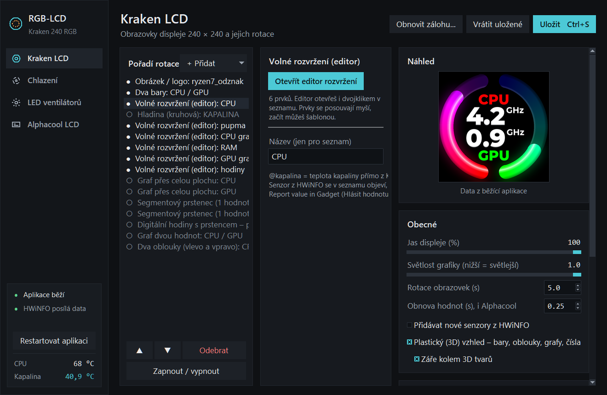
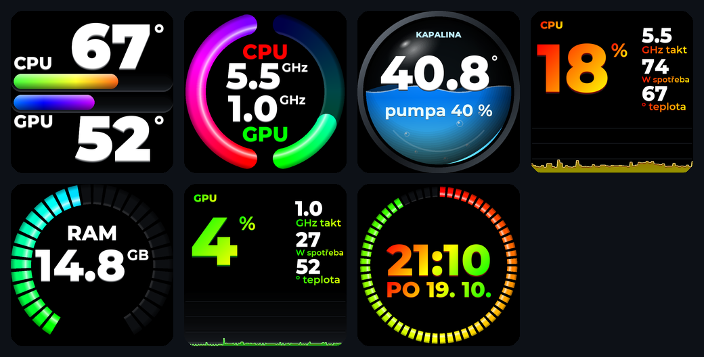
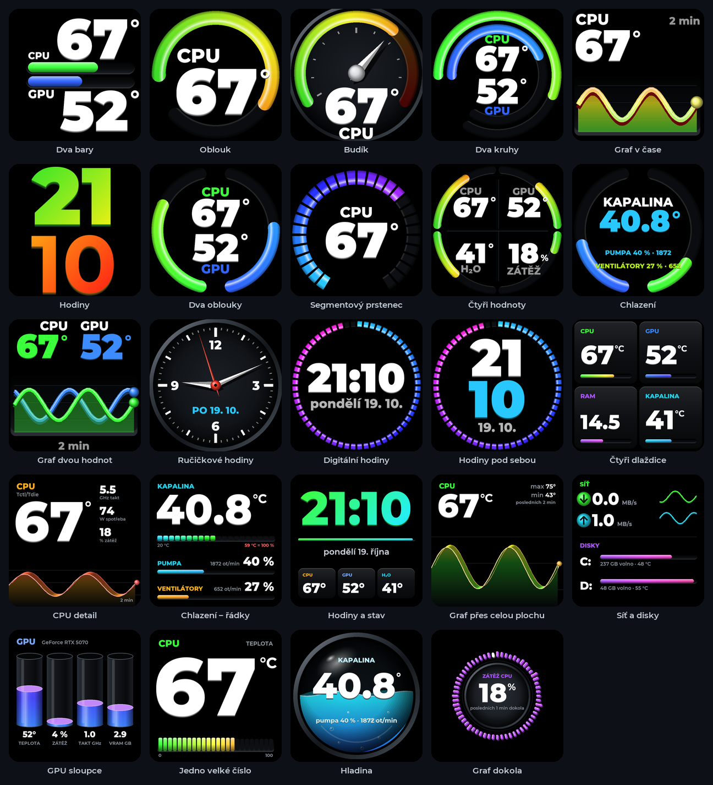
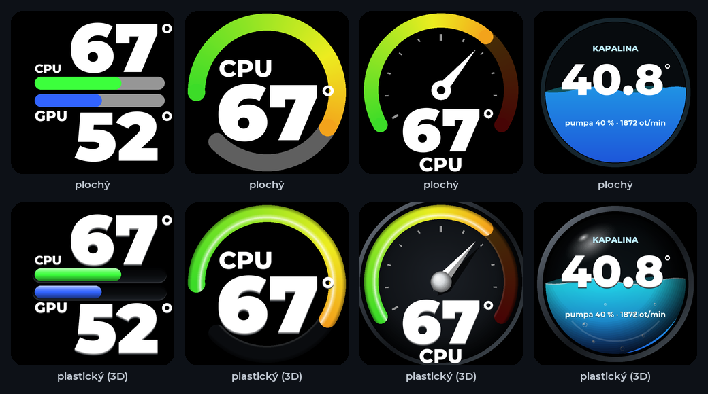
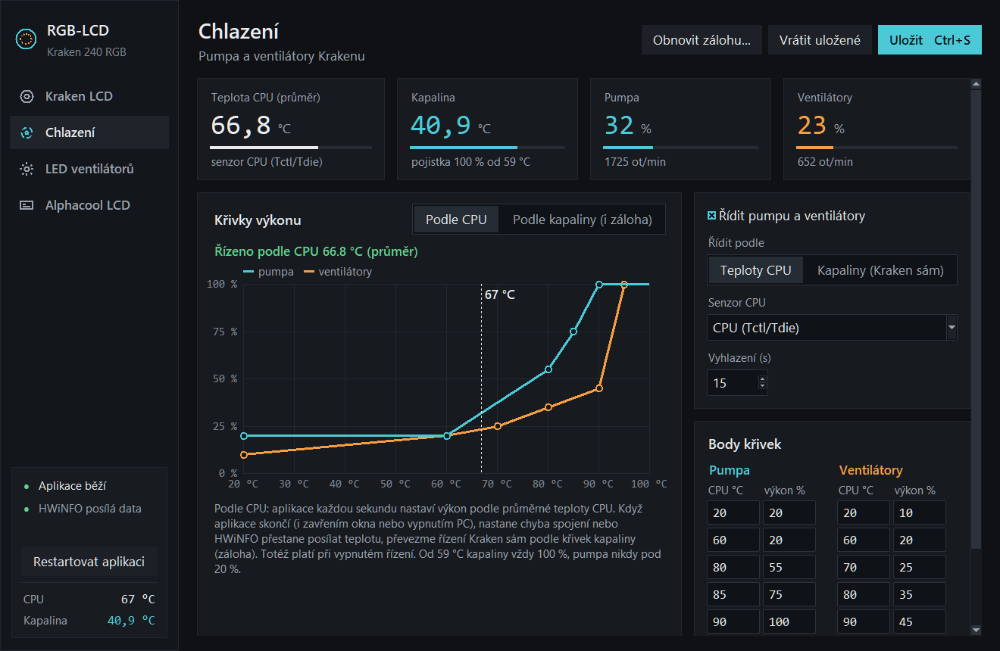
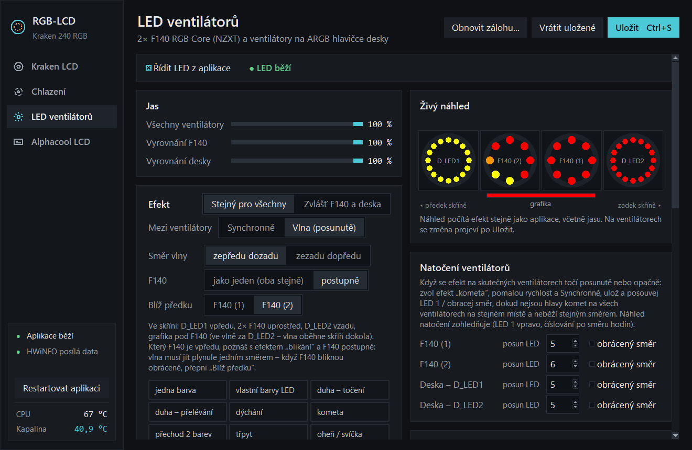
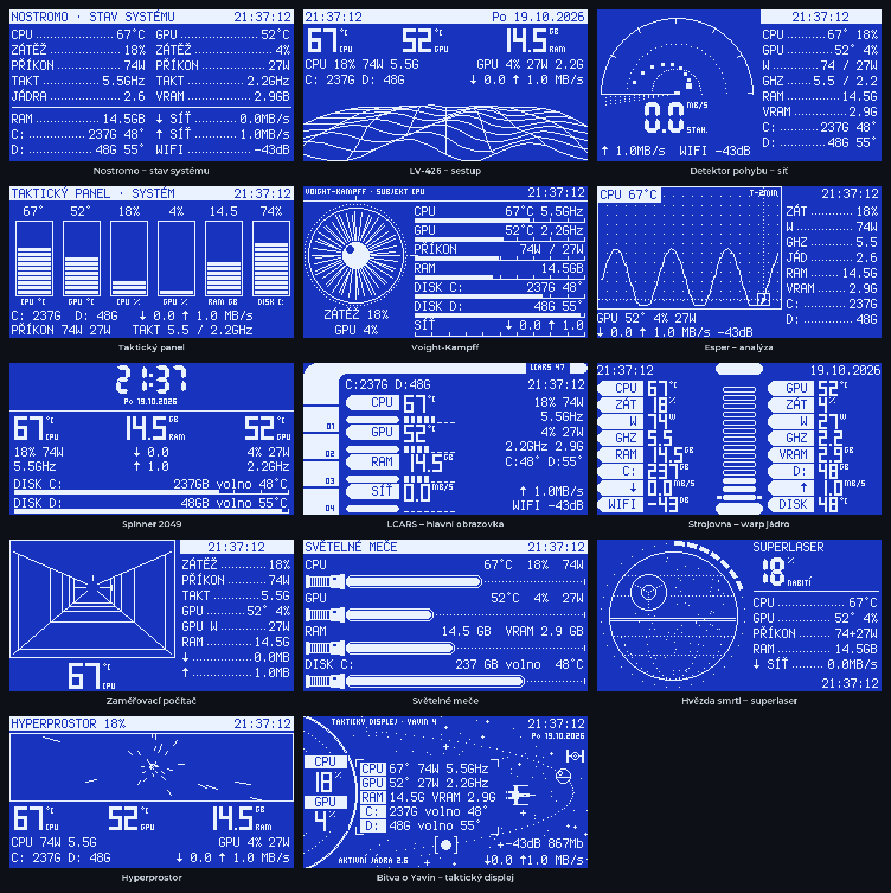
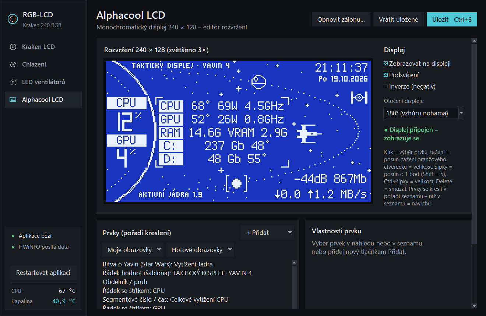

# RGB-LCD

**Jedna aplikace místo několika programů od výrobců.** RGB-LCD ovládá LCD displej vodního
chlazení NZXT Kraken, řídí pumpu a ventilátory podle teploty procesoru a sjednocuje RGB
podsvícení všech ventilátorů a grafické karty – bez NZXT CAM, Gigabyte Control Center /
RGB Fusion a dalšího softwaru výrobců, který běží na pozadí, navzájem se přetahuje o LED
a každý umí jen „svůj“ kus hardwaru.

Napsané v Pythonu pro Windows, nastavení v jednom okně, vše na jednom místě.



## Proč

Každý výrobce má vlastní program: NZXT CAM pro Kraken a jeho ventilátory, Gigabyte Control
Center pro LED na desce a grafice, Alphacool vlastní utilitu pro svůj displej. Programy se
spouštějí při startu, zabírají paměť, efekty LED nejdou sladit mezi
značkami (každý řadič má jiné vestavěné efekty i jas) a Kraken sám umí řídit pumpu jen
podle teploty kapaliny, ne procesoru.

Cíl projektu: **nahradit software výrobců jednou aplikací**, která

- umí všechno, co jsem z nich používal, a něco navíc,
- řídí všechna zařízení společně (jeden efekt LED přes celou skříň, jeden zdroj teplot),
- běží potichu na pozadí bez okna a nastavuje se v jednom přehledném okně.

## Co umí

### LCD displej Krakenu (240 × 240)

Obrazovky se střídají v rotaci, hodnoty se obnovují 4× za sekundu. K dispozici jsou
desítky hotových typů obrazovek a editor volného rozvržení, kde se dá obrazovka složit
z prvků (hodnoty, bary, oblouky, grafy, hodiny, budíky, ikony, šablony textu…).

Moje obrazovky (živá data):



Hotové typy obrazovek:



Plochý nebo plastický (3D) vzhled – drážky, lesk, skleněné válce a koule, kovová luneta:



Další:

- **Ikona spuštěné hry nebo programu** – při spuštění hry se na pár sekund ukáže její ikona
  (vytažená přímo z .exe) a název.
- Senzory z [HWiNFO](https://www.hwinfo.com/) (teploty, takty, zátěž, spotřeba…) a vlastní
  hodnoty přímo z Windows (volné místo na discích, rychlost sítě, signál Wi-Fi).
- Obrázky a loga s průhledným pozadím.

### Chlazení – pumpa a ventilátory podle teploty CPU



- Vlastní křivky pro pumpu a ventilátory (teplota CPU → výkon), vyhlazení teploty.
- **Pojistky:** když HWiNFO přestane posílat teplotu nebo zamrzne, nastane chyba spojení
  s Krakenem nebo se aplikace ukončí (i při vypnutí PC nebo odhlášení), nahrají se do
  Krakenu záložní křivky podle teploty kapaliny a Kraken se řídí sám.
- Log zátěže: kdy a jak dlouho jely ventilátory naplno, nejvyšší teploty.

### RGB LED – všechny ventilátory a grafická karta jako jeden celek



- Efekty počítá aplikace (~30 snímků/s) a posílá barvu každé LED zvlášť – stejně vypadají
  na ventilátorech NZXT, na ventilátorech připojených do desky Gigabyte i na pásku
  grafické karty.
- 38 efektů: duha, dýchání, kometa, oheň, polární záře, plazma, vodopád, bouřka,
  ohňostroj, barva podle teploty, hladina podle hodnoty senzoru…
- **Vlna přes celou skříň** – efekt putuje podle skutečného rozmístění ventilátorů
  (předek → horní ventilátory → zadek → grafika), nebo všechny synchronně.
- Vlastní barvy jednotlivých LED, natočení ventilátorů, vyrovnání jasu mezi značkami.
- Při uspání a vypnutí PC LED zhasnou (deska jinak drží poslední snímek).
- Živý náhled přímo v okně.

### Alphacool USB display 240 × 128 (volitelně)

Monochromatický displej s editorem rozvržení a hotovými obrazovkami ve stylu sci-fi
(Vetřelec, Blade Runner, Star Trek LCARS) a Star Wars:





## Hardware, na kterém to běží

| Zařízení | Co aplikace ovládá | Místo programu |
|---|---|---|
| NZXT Kraken 240 RGB (2023, PID 0x300E) | LCD, pumpa, ventilátory | NZXT CAM |
| NZXT RGB Controller 2023 + 2× F140 RGB Core | LED po jednotlivých diodách | NZXT CAM |
| Gigabyte B650M Aorus Elite (RGB Fusion 2.0) | ARGB hlavičky D_LED1/D_LED2, další zóny | Gigabyte Control Center |
| Gigabyte RTX 5070 EAGLE OC SFF | LED pásek karty | Gigabyte Control Center |
| Alphacool USB display 240×128 | displej | Alphacool software |

> Projekt je psaný pro jednu konkrétní sestavu. Na jiném hardwaru nemusí fungovat a protokoly
> LED desky a grafické karty jsou ověřené jen na uvedených modelech.

## Požadavky

- Windows 11, Python 3.12
- [HWiNFO64](https://www.hwinfo.com/) se zapnutým *Gadget reportingem*
  (zdroj teplot procesoru a grafiky)
- Balíčky Pythonu:

  ```bat
  py -m pip install -r requirements.txt
  ```

- NZXT CAM nesmí běžet – aplikace zastavuje službu `CAMService` (potřebuje práva správce).
  Gigabyte Control Center přepisuje LED desky – `autostart_zapnout.bat` vypne jeho
  automatické spouštění.
- Alphacool displej: ovladač WinUSB (přes [Zadig](https://zadig.akeo.ie/)).

## Spuštění

Aplikace počítá s umístěním ve složce `C:\RGB-LCD`.

| Soubor | Co dělá |
|---|---|
| `spustit.bat` | hlavní smyčka v okně konzole (pro ladění) |
| `nastaveni.bat` | okno nastavení |
| `autostart_zapnout.bat` | spouštění po přihlášení na pozadí bez okna (naplánovaná úloha), vypne autostart NZXT CAM a GCC |
| `autostart_vypnout.bat` | zruší autostart a vrátí NZXT CAM |
| `spustit_na_pozadi.bat` | spustí aplikaci na pozadí hned |
| `ukoncit.bat` | bezpečné ukončení aplikace na pozadí |

Změny v okně nastavení se po uložení projeví hned, bez restartu aplikace.

Aplikaci na pozadí ukončuj přes `ukoncit.bat` nebo tlačítko v okně nastavení – zabití
procesu ve Správci úloh přeskočí nahrání záložních křivek chlazení.

## Struktura

| Soubor | Účel |
|---|---|
| `rgb_lcd.py` | hlavní smyčka: senzory, rotace obrazovek, chlazení, stav pro okno |
| `kraken.py`, `cooling.py` | komunikace s Krakenem (liquidctl), řízení a pojistky chlazení |
| `screens.py`, `kraken_prvky.py`, `editor_kraken.py` | obrazovky LCD, prvky volného rozvržení, editor |
| `led.py`, `led_efekty.py`, `grafika.py`, `editor_led.py` | LED ventilátorů a grafiky, efekty, stránka LED |
| `alphacool.py`, `prvky*.py`, `mono.py`, `editor_alphacool.py` | displej Alphacool |
| `hwinfo.py`, `systemdata.py` | senzory z HWiNFO a z Windows |
| `program_ikona.py` | ikona spuštěné hry na LCD |
| `nastaveni.py`, `vzhled.py`, `config.py` | okno nastavení, tmavý vzhled, konfigurace |
| `ukonceni.py`, `camservice.py`, `autostart.ps1` | bezpečné ukončení, služba NZXT CAM, autostart |

## Obrázky a loga

Složka `obrazky/` (loga výrobců pro obrazovku „Obrázek“) není v repozitáři – loga jsou
ochranné známky jejich vlastníků. Vlastní obrázky stačí nakopírovat do `obrazky/`
(barevné s průhledným pozadím pro Kraken do `obrazky/kraken/`).

## Upozornění

Software mění výkon pumpy a ventilátorů a posílá nedokumentované příkazy řadičům LED.
Používáš ho na vlastní nebezpečí. Kraken má vlastní pojistku (100 % od 59 °C kapaliny),
ale ta nenahradí správně nastavené křivky.

## Poděkování

- [liquidctl](https://github.com/liquidctl/liquidctl) – komunikace s Krakenem a řadiči
- [OpenRGB](https://gitlab.com/CalcProgrammer1/OpenRGB) – popis protokolů RGB Fusion 2.0
  a LED grafické karty Gigabyte
- [serdisplib](https://serdisplib.sourceforge.net/) – protokol displeje Alphacool

## Licence

Kód: [GPL-3.0](LICENSE). Písma ve složce `fonts/` mají vlastní licence (SIL OFL, CC0,
BSD) – texty licencí jsou přiložené u nich.
